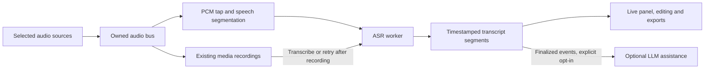

# Local transcription and live assistance roadmap

Updated: October 21, 2026. Status: v0.2.0 reliability release shipped. An isolated local transcription lab now implements short-file and live microphone paths with quantized Whisper Tiny/Base selection. The first Tiny/WASM measurements are complete; this is not integrated into the production recorder. See [the experiment and results](experiments/LOCAL_TRANSCRIPTION_01.md).

## Product direction

Let a user record and build a transcript locally in the same session. The transcript should also be recoverable by processing a completed recording. Later, finalized text can drive meeting notes, suggested questions, action items, or prompts during a livestream. Release the reliability candidate first, then validate this direction with a small experiment.

The user confirmed English first and reported perfect playback/transcription in a 40-second iPhone test of [Preview 2](experiments/LOCAL_TRANSCRIPTION_02.md). Extended automated checks then revealed omissions. [Preview 3](experiments/LOCAL_TRANSCRIPTION_03.md) bundles the newer engine, uses longer overlapping windows and retries suspicious results once with actual preceding audio. The full quiet reference now matches all 369 words; exact noisy-input replay improved from 112 word edits to two isolated edits. File/live checks and recording preservation pass in Firefox. Broader human speech/noise comparisons, Base/Moonshine, actual camera/screen integration, offline startup and phone interruptions remain gates. Automated WebKit could not launch; the newer engine has not been retested on physical iPhone. More manual phone testing is deferred at the user's request without blocking preview delivery.

Live text is the intended direction. A recorded-audio transcription feature is an early useful outcome and a fallback for devices that cannot transcribe fast enough while capturing video. Build both around the same transcript representation, so adding live assistance does not require replacing the first feature.

## Starting point and model choices

The companion TTS/STT app already contains a Transformers.js Whisper worker, quantized WASM inference, model download/cache controls, an AudioWorklet, speech/silence segmentation, provisional/final results, session IDs, cancellation, and bounded job handling. Review and adapt these units rather than copying the entire recorder hook: that app can stop capture when its transcription queue fills. Screen Recorder must keep recording when transcription stalls. Its worker is currently WASM-based; WebGPU would be a separate benchmark, not an already verified capability of that integration.

| Candidate | Why evaluate it | Decision to measure |
|---|---|---|
| Quantized Whisper Tiny through Transformers.js | Small-model starting point and reuse of existing speech-app work | Accuracy on actual target voices/languages; sustained speed during video capture |
| Whisper Base | Quality comparison if Tiny misses useful details | Whether improved accuracy justifies download, memory, and latency cost |
| Moonshine browser runtime | Alternative with documented live transcription updates and committed results | Comparable quality, language coverage, runtime maturity, integration with already-owned audio, and license |

[Transformers.js supports browser ASR and chunked audio](https://huggingface.co/docs/transformers.js/en/api/pipelines), with [WebGPU execution](https://huggingface.co/docs/transformers.js/en/guides/webgpu) and [quantized model options](https://huggingface.co/docs/transformers.js/en/guides/dtypes). The English Whisper `.en` checkpoints are English-only; evaluate a multilingual checkpoint when other languages are required. Pin a compatible library/runtime/model revision after the experiment; measure the actual downloaded artifacts rather than quoting parameter count or total repository size as download size.

Whisper live transcription requires audio segmentation, overlap handling, and stable-text reconciliation. A [WhisperTextStreamer](https://huggingface.co/docs/transformers.js/en/api/generation/streamers) reports generated text/chunk events; it does not by itself provide a microphone stream or solve audio buffering. The official [real-time Whisper example](https://github.com/huggingface/transformers.js-examples/tree/main/realtime-whisper-webgpu) is a useful reference. [Moonshine's browser SDK](https://dev.moonshine.ai/js/) documents provisional updates and committed results, making it a useful comparison rather than a preselected replacement.

## Audio and transcript architecture

- Reuse already-acquired selected audio; transcription must not open a second default microphone. Choose one logical audio bus per session rather than transcribing duplicate audio from every video and microphone output. Keep references back to the session and source.
- Tap PCM with an [AudioWorklet](https://developer.mozilla.org/en-US/docs/Web/API/AudioWorklet), downmix and resample to the selected model's input rate (16 kHz mono for the initial Whisper experiment), and send transferable buffers to a dedicated inference worker. Verify the actual context sample rate. Keep PCM processing bounded; avoid repeated whole-file decoding during live capture. MediaRecorder time slices are encoded container fragments and are not assumed to be independent decodable audio files.
- Start with speech/silence segmentation, a maximum utterance duration, a short overlap, and a bounded queue/ring buffer. Preserve a single sample-based timeline through silence and restarts; convert model-relative timestamps to session-relative timestamps. Merge overlaps without duplicate committed words. Prototype short rolling windows and roughly 1–2-second draft-update attempts, then tune from measurements; this is not a latency promise.
- Give each segment a stable ID, session/source ID, start/end time, text, revision, model/language provenance, and provisional/final status. Revisions replace provisional text. Finalized segments form an idempotent event stream that later consumers can use without reacting to every changed word. Segment/source labels do not imply speaker identification.
- Keep recording and transcription lifecycles independent. A model/worker error, timeout, GPU loss, or backlog pauses live transcription and offers processing from retained audio. Mark uncovered intervals/incomplete transcripts visibly. Do not silently drop finalized text or stop recording to make the queue shorter. Flush the final utterance on Stop; a recording can be ready while transcription is still finishing. Reject callbacks from cancelled sessions.
- Recorded-audio processing needs an explicit duration/memory limit at first. Decoding an entire long recording duplicates media memory; investigate incremental decoding/persistence before offering hour-long processing. A fallback can recover text only for audio that was actually retained.

## Phases and release gates

Effort below is a rough engineering estimate, not a delivery commitment. Browser/device validation adds elapsed time.

| Phase | Deliverable | Gate before progressing | Indicative effort |
|---|---|---|---|
| 0 — reliability | Refresh build advisories, finish 0.2.0 device/long-session acceptance, deploy an identifiable release | New CI pass and production smoke test; dependable media exports | Separate existing release work |
| 1 — feasibility | One recorded-audio path and one live PCM path; compare Tiny/Base and one streaming candidate | Representative voices/noise/languages, model download/memory measurements, and capture running concurrently | 1–2 days, capped discovery |
| 2 — useful local transcripts | Opt-in Transcribe action on a recording, transcript association, edit/copy/TXT export, timestamped JSON, load/cancel/retry/cache controls | Correct file/session association; cancellation, silence, final utterance, and playback tested | 3–5 days after model choice |
| 3 — live beta | Live transcript panel, stable/draft text, bounded buffering, progress/catch-up and after-stop fallback | Sustained 30-minute concurrent screen+camera+mic/transcription test; no recording regression or unbounded transcription queue | 3–5 days after spike, device-dependent |
| 4 — meeting/stream assistance | Explicit meeting audio selection, then rolling notes/questions/action-item suggestions from finalized segments | Supported capture matrix; clear source coverage; separately approved LLM route; useful suggestions with timestamp references | Scope after live-beta evidence |

Build the live path in phase 1 rather than waiting until all recorded-audio UI is complete. If it clears the resource/accuracy gates early, a limited live beta can accompany phase 2. A strong microphone-only livestream/narration use case can ship before full meeting coverage.

Phase 1 is underway. The extended-session repair and self-hosted runtime are now available in Preview 3. Next compare models and representative voices/noise, then choose a default before building the production transcript panel. Recording stability and recognition accuracy remain separate acceptance gates.

## Validation and resource budget

Benchmark a laptop with WebGPU, a WASM-only browser/device, and an iPhone-class device. Include quiet speech, silence, fan/music noise, names/numbers, rapid speech, source termination, missing audio, multiple mics, and the intended languages. Use consented test clips with reference text; report transcription errors separately from recording fidelity.

Record cold download and warm-start time, total model bytes, real-time factor (inference time divided by audio duration), time from spoken words/phrase end to draft/final text, queue depth, memory trend, and recording frame/audio continuity. Initial live target: sustain a real-time factor below 1 with headroom and no growing backlog; aim for useful text a few seconds behind speech on the explicitly tested device class. These are acceptance targets to measure, not achieved results. If a device misses them, offer recorded-audio mode.

Default to a quantized CPU/WASM baseline and benchmark WebGPU as an acceleration option. Capability checks alone do not prove an adapter/model will load. Keep working fallbacks and model cleanup. Compare accuracy across runtime/dtype variants instead of assuming equal results. A 30-minute test is an initial gate, not a claim of unlimited recording length. Longer-session recovery remains linked to the main resilience roadmap.

## Meeting audio and later LLM use

The current app does not request tab/system audio. With only a microphone selected, a headset meeting recording can omit remote participants. [Display audio availability depends on browser, OS, and the user's selected surface](https://developer.mozilla.org/en-US/docs/Web/API/MediaDevices/getDisplayMedia). Add explicit supported tab/system-audio capture and verify the returned audio tracks; display “microphone only” when remote audio is absent. Avoid feeding the same source twice or routing captured audio back to speakers. Per-source labels can be useful early; speaker diarization is separate later work.

After transcription works, keep an optional assistant as a separate subscriber to finalized transcript events. Feed it a bounded recent-text window plus a rolling summary on completed thoughts or user request, rather than invoking a model for each token. Useful first outputs are timestamp-linked notes, action-item candidates, suggested follow-up questions, and livestream talking points. Corrections to segments must invalidate/update dependent suggestions.

Choose local in-browser inference, a user-run local service, or a remote provider explicitly. A second browser model competes with ASR/video for resources, so benchmark concurrency before promising fully local live assistance. Remote/local-service routes require a visible destination, explicit user connection, and an appropriate credential/transport design; never embed a provider secret in the frontend bundle. Transcript text is source material, not permission to run tools, send messages, or follow spoken instructions. Suggested actions remain reviewable.

## Local-first delivery

Load models only when the user opts in, with progress, actual download size, cached-state/offline readiness, and deletion controls. Distinguish downloaded model assets from recording/transcript content. After cache verification, test processing with network disabled; cached models alone do not guarantee the entire app/runtime is offline-ready. Use self-hosted runtime assets where practical and review worker/WASM/model fetches against hosting headers/CSP when implementing. Add runtime/model licenses and notices for the exact pinned artifacts.

Keep transcripts in the tab by default, with explicit export and optional recovery semantics aligned to recording retention. Show which sources are being transcribed and whether results are draft, incomplete, or finished. Do not silently fall back from local transcription to browser/provider speech services. Connecting transcript text to any external assistant is a separate opt-in decision.
